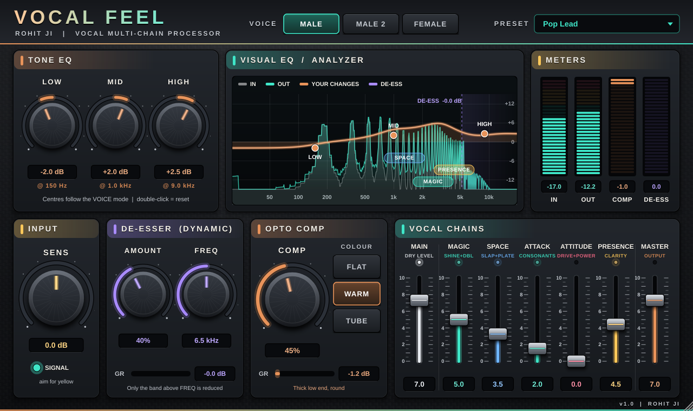

# Vocal Feel by ROHIT JI

A one-page **vocal multi-chain processor** for Windows (VST3, FL Studio / Cubase / any VST3 host).
It works the way famous "signature" vocal plugins do: your dry vocal runs through EQ, a de-esser and an opto
compressor, and **parallel effect chains** are blended in with faders. Each chain retunes itself for the
**VOICE** you pick (MALE / MALE 2 / FEMALE).

**SENS > TONE EQ > DYNAMIC DE-ESSER > OPTO COMP > MAIN  +  MAGIC / SPACE / ATTACK / ATTITUDE / PRESENCE > MASTER**

| Control | What it does |
|---|---|
| **VOICE** | MALE, MALE 2 (deeper) or FEMALE. Moves the EQ centres, the de-ess and presence bands and the slap time. |
| **SENS** | Input level into the processor. Aim for the **SIGNAL** LED to be yellow on loud parts. |
| **TONE EQ: LOW / MID / HIGH** | Low shelf, mid bell and high shelf, ±12 dB each, for balancing the voice. |
| **DE-ESSER (DYNAMIC)** | Manual dynamic band: **AMOUNT** and **FREQ** (3-12 kHz). Only loud sibilance above FREQ is turned down; the rest of the voice is untouched. |
| **OPTO COMP** | Smooth opto compressor with program-dependent release and colour: **FLAT** (clean), **WARM** (thick, round) or **TUBE** (triode glow). |
| **MAIN** | Level of the processed dry vocal (7 = unity, 0 = off, so you can hear the chains alone). |
| **MAGIC** | Bright compressed shine plus a wide micro-doubler. |
| **SPACE** | Voice-timed slap-back plus a short plate. |
| **ATTACK** | Brings out consonants and the start of words. |
| **ATTITUDE** | Driven, squashed mid band for power and authority. |
| **PRESENCE** | Compressed articulation band plus air for clarity. |
| **MASTER** | Output level (7 = unity). |

The **VISUAL EQ / ANALYZER** shows the input spectrum (grey), the output spectrum (mint), the total curve of your
changes (copper, with LOW / MID / HIGH nodes and the chain bands) and the de-ess band working live (violet).
METERS show IN, OUT, COMP and DE-ESS gain reduction.

Presets: Init, Pop Lead, Rap Power, Bhojpuri Bright, Devotional Warm, Podcast / Voice-Over, Female Air,
Slapback Retro, Intimate Close, Big Chorus Vocal, Deep Male.

## Download

Go to **[Releases](../../releases/latest)** and pick:

| File | For |
|---|---|
| **Vocal-Feel-Setup-64bit.exe** | 64-bit FL Studio, Cubase and other modern DAWs (most people) |
| **Vocal-Feel-Setup-32bit.exe** | Older 32-bit DAWs only |

Run it and click **Next > Install > Finish**. The plugin goes to `C:\Program Files\Common Files\VST3`.

## How it is built

Every push builds the plugin with MSVC (x64 and Win32) on GitHub Actions, packages each into its own
setup wizard (`Installer/setup.iss`, Inno Setup) and publishes them as the latest release.
Vocal Feel is an original design and is not affiliated with any other plugin maker.
